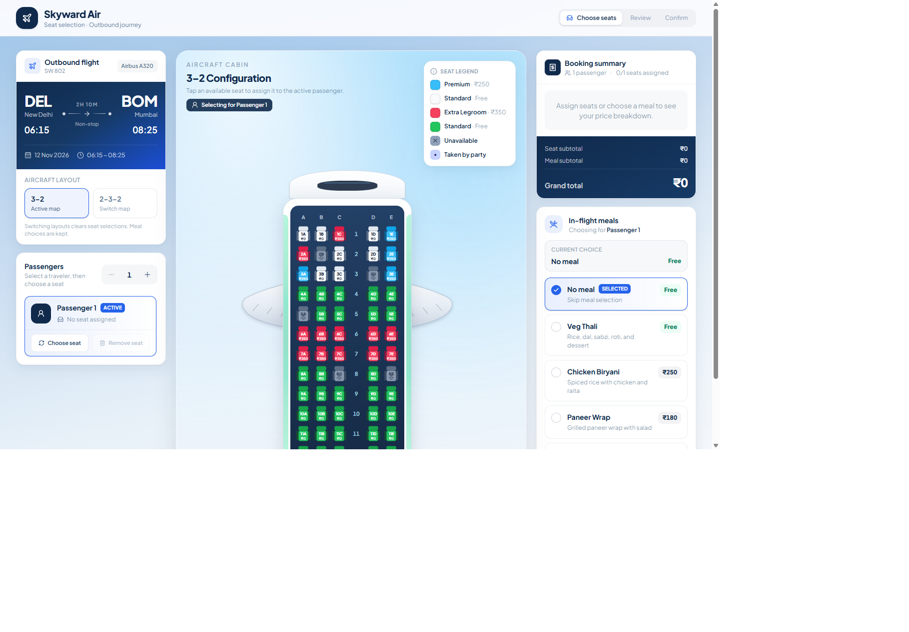
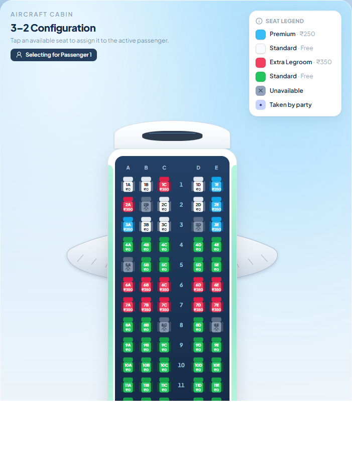
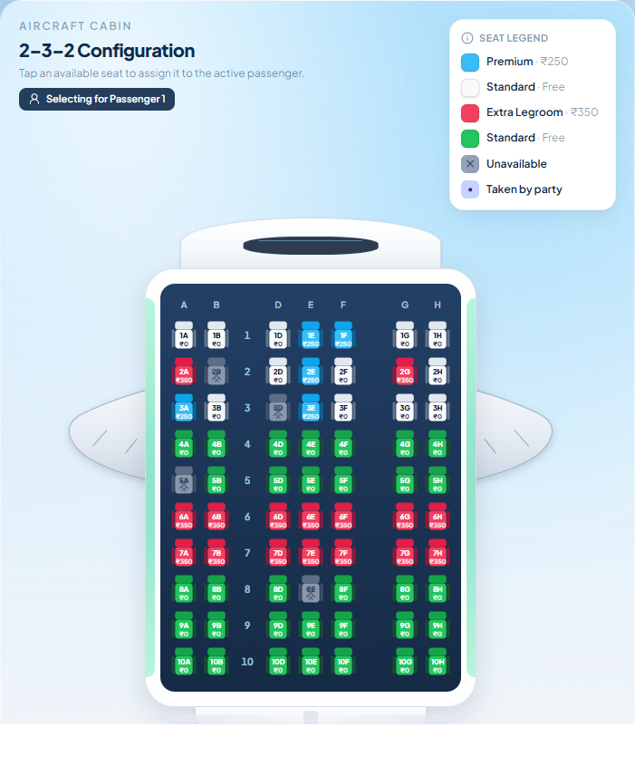
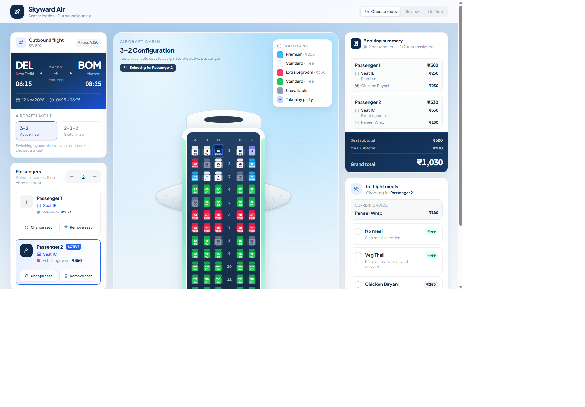
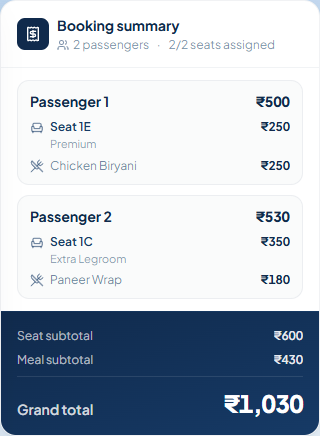
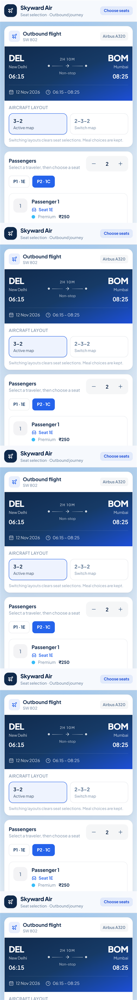

# Skyward Air — Flight Seat Selection & Passenger Management

React + Vite frontend assessment app for assigning aircraft seats and meals to passengers, with live pricing.

## 📸 Project Screenshots

### 1. Desktop Dashboard



Premium three-column Skyward Air dashboard with flight details, passenger controls, interactive aircraft cabin, booking summary, and meal selection.

### 2. Aircraft Layout — 3–2



Top-down aircraft cabin in the **3–2** configuration (`A B C | D E`), including wings, engines, seat legend, and readable seat labels.

### 3. Aircraft Layout — 2–3–2



Alternate **2–3–2** configuration (`A B | D E F | G H`) with seven seats per row and dual aisles.

### 4. Passenger Seat Assignment



Two passengers with independent seat assignments, clear selected vs taken-by-party indicators, and per-passenger assignment details.

### 5. Booking Summary



Live pricing breakdown with paid seats, paid meals, seat subtotal, meal subtotal, and grand total.

### 6. Mobile Responsive Design



Responsive single-column layout at mobile width, preserving flight info, passenger switching, aircraft cabin, meals, and booking totals.

## Features

- Interactive 3–2 and 2–3–2 aircraft seat maps
- Passenger management with active-passenger seat assignment
- Occupied / selected / taken seat states
- Real-time seat and meal pricing
- Passenger-specific meal selection
- Responsive desktop, tablet, and mobile layouts
- Keyboard-accessible controls and focus states

## Stack

- React 19 + Vite 8
- Tailwind CSS v4
- Lucide React
- Vitest (unit tests)
- Mock data only (no backend)

## Scripts

```bash
npm install
npm run dev
npm run test
npm run lint
npm run build
```

## State management

All booking state lives in `App.jsx`:

| State | Purpose |
| --- | --- |
| `layoutId` | Active aircraft configuration (`3–2` or `2–3–2`) |
| `passengers` | List of `{ id, name, seatId, mealId }` |
| `selectedPassengerId` | Passenger currently assigning a seat/meal |
| `nextPassengerIndex` | Stable index for new passenger IDs |
| `feedback` | Short status / invalid-action messages |

Pricing is **derived**, not stored. `buildBookingSummary(passengers, seats)` recalculates seat/meal subtotals and the grand total on every render.

## Seat assignment logic

Pure helpers in `src/utils/assignment.js`:

1. User selects an active passenger.
2. Clicking a seat runs `evaluateSeatSelection`:
   - Rejects occupied seats.
   - Rejects seats already assigned to another passenger.
   - Clears the seat if the active passenger clicks their current seat again.
   - Otherwise assigns/replaces the seat for that passenger only.
3. Switching passengers keeps prior assignments (`takenSeatIds` vs `activeSeatId`).
4. Switching aircraft layouts clears seats but keeps meal choices (`clearAllSeats`).
5. Removing a passenger drops their seat and meal with them.

## Aircraft layouts

- **3–2:** `A B C | D E` (12 rows)
- **2–3–2:** `A B | D E F | G H` (10 rows; column C skipped)

Mock prices follow the assessment sample (e.g. `1C` ₹350, `1E` ₹250, free standards ₹0).

## Project structure

```
src/
  components/   Header, FlightDetails, PassengerList, AircraftIllustration,
                SeatMap, Seat, MealSelector, BookingSummary
  data/         aircraft.js, meals.js
  utils/        assignment.js, pricing.js
  App.jsx
screenshots/    README demo captures
```
